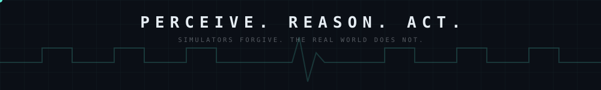

<!-- ═════════════════════ HEADER ═════════════════════ -->

  

  

  
  
  
  

  
  
  
  
  

 

<h3 align="center">
Most AI stops at the screen. 
Mine has to see the room, decide, and move something real.
</h3>

 

<!-- ═════════════════════ THESIS ═════════════════════ -->
<h2 align="center">⟡ &nbsp;T H E &nbsp; T H E S I S &nbsp; ⟡</h2>

<i>
In 1988 Hans Moravec noticed the cruel joke of robotics: chess is easy, perception is hard. 
Four decades on, the joke still runs the field. I work on the hard half.
</i>

I build <b>real-world humanoid robotics systems</b>: perception, behaviour, and embodied AI pipelines 
deployed on <b>physical robots</b> using ROS2, Jetson, and VLM / VLA reasoning. 
It started in grade 8. It became a practice in systems that must <b>survive</b> noisy sensors, 
tight memory and unforgiving latency. Simulators forgive. The real world does not.

  
  
  
  
  

 

<!-- ═════════════════════ RIGHT NOW ═════════════════════ -->
<h2 align="center">⟡ &nbsp;R I G H T &nbsp; N O W &nbsp; ⟡</h2>

<i>
One learning to see a factory floor. 
One listening for a heartbeat that has not yet drawn its first breath.
</i>

<table align="center">
<tr>
<td width="50%" valign="top">

<h3 align="center">AI Engineer · R&D</h3>

  <a href="https://www.ihubrobotics.com/"><b>I Hub Research &amp; Robotics</b></a> 
  Jul 2025 → present

An Indian deep-tech lab building humanoid and semi-humanoid service robots end to end: chassis, embedded systems, and a **vision-language-action stack built from scratch**, spanning object detection, task planning, motion control and autonomous navigation on NVIDIA Jetson compute. First Indian company selected for NVIDIA's Humanoid Robotics Program, with robots deployed across India and the Gulf.

<b>My surface of that stack</b>

- Perception pipelines with **DINOv3 · SAM 2.1 · Depth Anything · DUSt3R** for object understanding, spatial reasoning, affordance detection and scene segmentation
- **Speech → Intent → Action**: Whisper plus VAD filtering plus an instruction-following LLM for command grounding
- A **VLA-driven behaviour logic engine** giving reasoning-based task planning to healthcare and education humanoids
- Dockerized deployment on **Jetson Orin Nano**, tuned to real-world latency budgets
- Industrial vision with **TVS Automobiles**: alloy defect and paint anomaly detection on a live line

</td>
<td width="50%" valign="top">

<h3 align="center">Founder</h3>

  <a href="https://nextgenrl.com/"><b>Nextgen Research Lab &amp; Infrastructure Development Pvt. Ltd.</b></a> 
  Indigenous deep-tech · healthcare intelligence

Building **[MaaKosh](https://nextgenrl.com/)**, an AI-enabled *early-risk intelligence* platform for maternal and neonatal care. Not a device. A continuous system running from the body to the dashboard, built to surface warning signs while they can still be acted on.

- Smart Belly Band · Neonatal Patch · clinical dashboard
- On-device ML, risk models, clinical decision support
- **Supervised testing at RML Hospital, Delhi**
- Patent preparation initiated, moving prototype → pilot

Also **[VitaSense](https://vitasense.nextgenrl.com/)**, portable screening for early childhood developmental and nutritional risk, built for Anganwadi and ASHA workers with explainable insights.

<h3 align="center">Student</h3>

  <b>B.Tech CSE · Gautam Buddha University</b> 
  Class of 2028

</td>
</tr>
</table>

 

<!-- ═════════════════════ OPEN SOURCE ═════════════════════ -->
<h2 align="center">⟡ &nbsp;O P E N &nbsp; S O U R C E &nbsp; ⟡</h2>

  
  
  
  

  <b><a href="https://github.com/VinRobotics/vla.cpp">vla.cpp</a></b> is a unified C++ inference runtime for Vision-Language-Action models 
  (SmolVLA, π0, GR00T N1.x), built on llama.cpp for Jetson-class deployment. 
  The unglamorous layer where a policy stops being a research artifact 
  and starts being something a robot can actually run.

  <a href="https://github.com/VinRobotics/vla.cpp/pull/12"><b>PR #12</b></a> &nbsp;·&nbsp; Windows (WSL2 + CUDA 12.6) build guide
  &nbsp;&nbsp;|&nbsp;&nbsp;
  <a href="https://github.com/VinRobotics/vla.cpp/pull/17"><b>PR #17</b></a>

 

<!-- ═════════════════════ ARSENAL ═════════════════════ -->
<h2 align="center">⟡ &nbsp;A R S E N A L &nbsp; ⟡</h2>

<h3 align="center">AI &amp; Machine Learning</h3>

  
  
  
  
  
  
  
  
  

<h3 align="center">Robotics &amp; Perception</h3>

  
  
  
  
  
  

<h3 align="center">Hardware, Edge &amp; Cloud</h3>

  
  
  
  
  
  
  
  

  

 

<!-- ═════════════════════ RESEARCH ═════════════════════ -->
<h2 align="center">⟡ &nbsp;R E S E A R C H &nbsp; ⟡</h2>

<h3 align="center">Real-Time Multi-Modal Sensor for Field-Based Microplastic Detection</h3>

  <b>IEEE · ICECSBHI 2026</b> 
  <a href="https://ieeexplore.ieee.org/document/11469066/">Read on IEEE Xplore →</a>

Optical sensing, impedance analysis and AI-enhanced microscopy fused into one field-deployable instrument, 
driven by a YOLOv8-based ML fusion model, with an IoT companion app for geotagged contamination mapping. 
<i>Lab-grade detection, minus the lab. Environmental monitoring that works where the water actually is.</i>

  
  
  
  

 

<!-- ═════════════════════ RECOGNITION ═════════════════════ -->
<h2 align="center">⟡ &nbsp;R E C O G N I T I O N &nbsp; ⟡</h2>

|               Result                |                     Program                      |
| :---------------------------------: | :----------------------------------------------: |
|     **Top 25 Startups, India**      |     NASSCOM AI CoE *(with Govt. of Gujarat)*     |
|            **Selected**             | UP Deeptech Mission + BlueHill VC Pitching Round |
|          **India Top 16**           |  BioMed Bharat 2026 Biomedical Device Hackathon  |
|            **Qualified**            |           Google's AI for Future Fund            |
|          **India Top 100**          |   Bhasha Bandhu *(Microsoft &times; Bhashini)*   |
|         **Paper Published**         |           IEEE &middot; ICECSBHI 2026            |
|        **Community Speaker**        |      Arduino.cc *(AI &amp; IoT innovation)*      |
| **2nd Place, twice** *(2025, 2026)* |                Ignition Hackathon                |
|            **1st Place**            |              Ignition IoT Challenge              |
|            **2nd Place**            |            GBU Entrepreneur Hackathon            |
| **Science &amp; Innovation Award**  |                 Amity University                 |
|             **Winner**              |      CBSE Regional Science Exhibition 2023       |

 

<!-- ═════════════════════ CONTACT ═════════════════════ -->
<h2 align="center">⟡ &nbsp;L E T ' S &nbsp; B U I L D &nbsp; ⟡</h2>

Open to <b>research and engineering roles</b>, collaborations, pilots, and good problems. 
Especially the ones involving a robot, a hospital, or a deadline that scares people.

  
  
  
  

<i>
कर्मण्येवाधिकारस्ते मा फलेषु कदाचन। 
श्रीमद्भगवद्गीता 2.47
</i>

<!-- ═════════════════════ STATS ═════════════════════ -->

  
  

  

